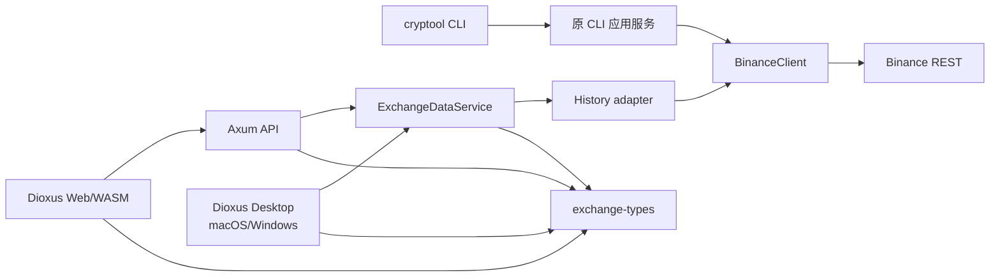

# cryptool / Exchange Data 代码分析报告

## 概要

- 分析模式：标准（架构、代码质量、安全），补充并发、性能边界和发布状态。
- 分析时间：2026-09-11。
- 代码基线：`5093712`，`main` 分支。
- 代码规模：123 个受版本控制文件；66 个 Rust 文件，共 7,010 行物理源码（包含测试、注释和空行）。
- 工程形态：Rust 2024 workspace，包含 `cryptool`、`exchange-types`、`exchange-ui` 三个 crate。
- 产品定位：Binance 现货与 USDⓈ-M 规则/历史成交查询工具，保留 CLI，同时提供 Dioxus Web、Axum API 和 macOS/Windows Desktop。

项目已经从单一 CLI 扩展为共享查询内核的多入口应用。它不包含策略、自动下单、撤单、持仓管理、回测或交易风控，因此属于数据查询与排障平台，不是高频交易执行系统。

## 架构评估

`exchange-types` 是 Native/WASM 共用的数据契约层，不依赖 Tokio、reqwest、clap 或本机 I/O。Web 通过同源 HTTP 调用 Axum；Desktop 直接调用 `ExchangeDataService`，不启动 localhost 服务或 CLI 子进程。旧 CLI 继续使用原 `app/domain/output` 路径，其功能边界没有被 GUI 扩大。

仓库未发现内部循环依赖。主要边界和调用链详见[架构概览](architecture.md)、[模块设计](module-design.md)和[数据流](data-flow.md)。

### 当前能力

| 入口 | 已实现 | 明确未实现 |
|---|---|---|
| CLI | 现货/合约规则、历史成交、JSON/表格输出 | `account balance` 仍返回 `NotImplemented` |
| Web | 首页、现货成交、USD-M 成交、时间转换、主题/导航 | 规则、账户、签名和交易功能没有 Web 页面/API |
| Desktop | 与 Web 共用页面；原生直连查询服务 | Linux Desktop；账户和交易功能 |
| Axum | 健康检查、成交窗口查询、内嵌或外置静态资源 | 用户体系、鉴权、CORS、多租户、规则/账户 API |

### 配置与安全边界

配置加载顺序为内置默认值或指定 TOML，再由 `BINANCE_API_KEY`、`BINANCE_PRIVATE_KEY` 和 CLI 覆写对应字段。TOML 支持部分配置；现货与合约基地址保持独立。代理支持 `auto`、`direct`、HTTP(S) 和 SOCKS5/SOCKS5h，并校验协议、主机、路径及认证字段。

Web 凭据只在 Axum 进程中；Desktop 凭据只在原生进程中。页面不会接收 API Key、私钥或代理密码。配置 Debug、UI 错误和服务错误均避免输出敏感值。直接执行 `cryptool serve` 默认监听 `127.0.0.1:8080`；推荐的 `server.sh` 默认监听 `0.0.0.0:8080`，自动发现局域网地址并生成 Host 白名单。Axum 校验 Host、Origin、方法和 GET body；非回环直接启动要求显式 `--allow-host`。

## 并发与性能边界

- CLI 的单次命令顺序执行，复用一个 reqwest 客户端连接池。
- `ExchangeDataService` 默认允许 4 个并发查询；超额请求立即返回结构化限流错误。
- 每个查询默认单请求超时 10 秒、总预算 30 秒、最多 6 次上游调用。
- 每次上游调用遇到可重试的瞬时错误时最多重试一次；429/418 写入共享冷却状态。
- 查询取消会取消在途 HTTP future 并释放 RAII semaphore permit；冷却 Mutex 不跨 `await`。
- GUI/API history adapter 的每次响应最多读取 2 MiB，最终窗口最多 1,000 行。
- ID、时间、价格和数量跨 JSON/WASM 边界时不使用浮点；ID/时间使用字符串协议，价格/数量先以 Decimal 校验后保留原文本。

本地性能记录显示：100/1,000 条查询到 DOM 更新的少量样本中位数分别为 37.7 ms/46.3 ms；macOS 窗口可见中位数为 837.3 ms，主进程 RSS 约 56 MiB。数据来自同机 fixture，不能代表 Binance 网络延迟、生产吞吐或 p95/p99。详见[本地性能记录](exchange-data-performance.md)。

## 发现问题

| 优先级 | 类别 | 当前问题 | 位置 | 建议 |
|---|---|---|---|---|
| P1 | 访问控制 | Host/Origin 校验不能替代身份认证；局域网用户可使用服务端配置的 Key 发起查询并消耗上游额度 | `src/server/mod.rs` | 生产或多人局域网部署在 Nginx/网关增加 TLS、身份认证、请求频率与来源限制 |
| P1 | 平台验收 | Windows 构建脚本和 CI 已配置，但 NSIS 安装、WebView2、图标和真实窗口尚未实机验收 | `scripts/app/windows/`、`.github/workflows/verify.yml` | 在 Windows x86_64 执行构建、安装、查询和升级/卸载验收，记录安装包 SHA-256 |
| P2 | 原 CLI 边界 | `TradeWindowQuery` 的公共字段和 Deserialize 可绕过构造校验；当前 CLI 路径安全，但作为 library 类型时不封闭不变量 | `src/domain/trade.rs` | 封闭字段或自定义反序列化，并让 `limit()` 返回可传播错误 |
| P2 | 原 CLI 响应 | 原 `BinanceClient::decode_response` 使用 `response.text()`，没有 GUI/API history adapter 的 2 MiB 流式上限 | `src/binance/client.rs` | 复用有限响应读取器，保留结构化 Binance 错误映射 |
| P2 | 可观测性 | 有 tracing 请求日志，但没有 metrics、分布式追踪、上游耗时分解或告警 | `src/server/mod.rs`、`src/cli/serve.rs` | 增加请求数、错误码、429、上游延迟、队列拒绝和调用预算指标 |
| P2 | 服务托管 | `server.sh` 提供 PID/日志管理，生产级进程恢复仍依赖外部 systemd/容器 | `scripts/web/server.sh` | 生产环境用 systemd 或容器执行 `run`，配置重启、日志轮转和健康检查 |
| P2 | 桌面分发 | macOS 当前为 ad-hoc 签名，Windows 尚无代码签名 | `scripts/app/macos/build.sh`、`scripts/app/windows/build.ps1` | 对外分发时接入 Developer ID/notarization 和 Windows Authenticode |
| P2 | 供应链 | 当前 `cargo-audit` 仍报告 lock-only、支持 feature 不可达的 `rkyv 0.7.46` advisory；另有 6 个维护/可靠性警告和 1 个 yanked lock 条目 | `Cargo.lock`、`docs/exchange-data-dependency-audit.md` | CI 固定运行审计；依赖图变化或启用 rkyv 时重新评估升级 |
| P3 | 功能边界 | 账户命令、Ed25519 私有请求和订单/持仓类型仍是预留能力 | `src/app/account.rs`、`src/binance/account.rs` | 保持明确的 NotImplemented，只有确定私有业务后再补权限、对账和风控 |

当前未确认 P0 问题。此前报告中的“合约 URL 被强制覆盖”和“JSON stdout 被诊断污染”已经修复并有回归覆盖。窗口二次校验和 2 MiB 响应上限属于新增 GUI/API 查询链；原 CLI 对应边界仍按上表记录。

## 代码质量

### 测试和检查

2026-09-11 在 Rust 1.98.0 和当前 `Cargo.lock` 上重新执行：

| 检查 | 结果 |
|---|---|
| workspace Desktop/native 测试组合 | 58 passed，13 suites |
| 严格 Clippy（Desktop/native 组合，`-D warnings`） | 通过 |
| `cargo fmt --all -- --check` | 通过 |
| macOS 应用构建、plist、ICNS、严格签名检查 | 通过 |
| Web 内嵌构建 | 通过 |
| Ubuntu x86_64 交叉构建 | ELF x86-64，最高 GLIBC 2.17，压缩包和 SHA-256 通过 |
| Windows 实机构建 | 未执行 |
| cargo-audit 0.22.2（数据库 1,243 条 advisory） | 原始审计退出 1：1 个 `rkyv` vulnerability、6 个 allowed warnings、1 个 yanked 条目；可达性见独立审计记录 |

自动测试覆盖共享时间/DTO、CLI JSON 和配置回归、服务端分页/预算/取消/冷却、HTTP/SOCKS5h 代理、Axum Host/Origin/方法/body/路由边界，以及 UI 表单状态和过期请求保护。TradeTable 的浏览器分页属于既有 Web 实际 QA，不计入上述 58 项自动测试。真实 Binance、真实 Key、Windows 原生交互和生产网络性能未纳入自动测试。

### 错误处理

CLI 使用 `AppError` 区分配置、HTTP、Binance、输入、未找到、序列化和未实现。GUI/API 使用稳定的 `QueryError` 错误码、重试属性与冷却信息。GUI/API 的 history adapter 限制响应体大小并拒绝异常 Decimal/时间；后续分页失败可以返回显式 `partial` 结果，尚未确认时间锚点时不会伪造完整窗口。原 CLI 的通用响应解码尚未使用该限长读取器。

主要不足在运维层：没有指标告警、长期日志轮转和进程守护内建实现。此边界由反向代理、systemd 或容器平台承担。

## 安全审计

| 检查项 | 当前状态 |
|---|---|
| API Key / Secret | 本地配置被 Git 忽略；支持环境变量；Debug 和 UI/API 错误脱敏 |
| 私钥传播 | GUI 查询服务会清除未使用的私钥；浏览器页面不接收凭据 |
| 输入校验 | symbol 支持 Unicode 字母/数字与 `_`，限制长度；窗口、时间、重复/未知 query 参数均校验 |
| HTTP 边界 | 禁止重定向；GUI/API history 响应限长；直接非回环启动需 allow-host；限制跨站 Origin、错误方法和带 body 的 GET |
| 代理 | 校验模式、scheme、主机、路径和认证字段；支持显式 direct 禁用环境代理 |
| 部署 | Ubuntu 目标目录和程序由 root 持有；拒绝配置、PID、日志及受管文件符号链接 |
| 依赖 | h2 已升级到修复版本；剩余 RustSec 项按实际 feature/target 可达性记录 |

Web 本身没有用户认证。允许他人访问前必须把它视为内部服务，通过网关补足身份认证和传输安全。

## 改进建议

1. 完成 Windows 实机安装与运行验收，这是当前交付闭环的最大缺口。
2. 为多人或生产 Web 部署增加反向代理认证、TLS、限流、systemd/容器托管与日志轮转。
3. 增加 Prometheus/OpenTelemetry 指标，分别测量服务排队、Binance 调用、重试和页面端到端耗时。
4. 在 CI 固定运行 cargo-audit，并保留 feature/target 可达性说明，避免简单忽略 lock-only advisory。
5. 只有项目进入账户或交易执行范围后，再设计权限隔离、幂等订单、限额、持仓、回撤、对账和故障恢复。

## 附录

### 关键文件

1. `src/main.rs`、`src/cli/serve.rs`：CLI 与 Web 服务入口。
2. `src/app/exchange_data.rs`：GUI/API 查询预算、并发、分页与重试。
3. `src/binance/history.rs`：历史成交传输、认证和响应校验。
4. `src/server/mod.rs`：Axum 路由和 HTTP 安全边界。
5. `crates/exchange-types/`：Native/WASM 共享契约和时间处理。
6. `apps/exchange-ui/`：Dioxus 页面及 Web/Desktop adapter。
7. `scripts/app/`、`scripts/web/`：平台构建、打包、安装与部署。
8. `tests/`：CLI、查询、代理、HTTP 和脚本契约测试。

### 发布支持矩阵

| 交付物 | 支持平台 | 当前状态 |
|---|---|---|
| CLI | macOS、Windows、Linux（按目标构建） | 原功能保留 |
| Dioxus Web + Axum | macOS 本机、Ubuntu x86_64 服务器 | 已构建验证 |
| Dioxus Desktop | macOS | 构建和窗口创建通过；原生视觉/交互未完整验收 |
| Dioxus Desktop | Windows | 脚本/CI 已配置，等待实机验收 |
| Dioxus Desktop | Linux | 不支持 |
