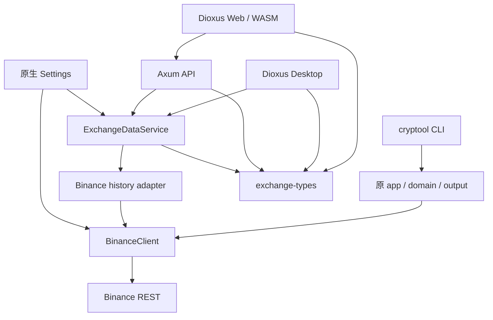

# cryptool / Exchange Data 架构

本文按 2026-09-11 的 `main` 分支（`5093712`）核对。项目在原 Rust CLI 上增加 Dioxus Web、Axum 和 macOS / Windows Desktop；当前分析见[代码分析报告](analysis-report.md)，实际运行验证见[验收记录](exchange-data-acceptance.md)。

## 能力边界

| 入口 | 能力 |
|---|---|
| cryptool CLI | 原现货/合约规则查询、历史成交、JSON/表格输出；账户与签名预留状态不变 |
| Web | 首页、现货成交、合约成交、时间转换及导航/页签/主题 |
| Desktop | 同一组 Dioxus 页面；只支持 macOS / Windows |
| Axum API | 健康检查与成交窗口查询，不暴露账户、规则或签名接口 |

没有新增策略、交易执行、回测、数据库或多租户用户系统。

## 工作区

```text
cryptool/
├── src/
│   ├── main.rs              # 原 CLI + 可选 serve 命令
│   ├── lib.rs               # 原生应用 library
│   ├── app/exchange_data.rs # GUI 共用的查询编排与预算
│   ├── binance/history.rs   # GUI 成交传输、认证、精度与解码
│   ├── server/              # 可选 Axum adapter 与静态资源
│   ├── cli/                 # 原命令与 serve 参数
│   ├── config/              # TOML、环境、代理与查询预算
│   ├── domain/              # 原 CLI 领域模型
│   └── output/              # CLI JSON / table
├── crates/exchange-types/   # Native / WASM 共享 DTO、时间、校验
├── apps/exchange-ui/        # 共享页面 + Web / Desktop 平台适配
├── tests/                   # CLI、原生服务、代理、HTTP 契约
├── scripts/
│   ├── app/macos/           # macOS 构建与安装
│   ├── app/windows/         # Windows 构建与安装
│   ├── web/                 # Web 构建、Ubuntu 打包/部署和服务管理
│   └── lib/                 # Bash 公共函数
└── .github/workflows/       # macOS / Windows 验证与打包
```

## 依赖关系



`exchange-types` 不依赖 reqwest、Tokio、clap 或本机 I/O。WASM 不链接原生核心；Desktop 的依赖 feature 才启用 cryptool 与本机配置读取。`OutputFormat` 已移至中立 config 模块，消除原 `config → output` 依赖。依赖方向以原生核心和共享类型为下层，不从服务反向调用 UI。

## 技术栈与取舍

| 层 | 选择 | 取舍 |
|---|---|---|
| 共享 UI | Dioxus 0.7.10、Rust RSX、CSS | 一套页面覆盖 Web/Desktop；保留系统 WebView 的平台差异 |
| Web 服务 | Axum 0.8、Tokio | 显式 REST 契约，易于测试；需要维护请求 DTO 到领域查询的映射 |
| 桌面 | Dioxus Desktop | 直接调用服务，无 localhost 端口；网络任务须运行于原生 Tokio 环境 |
| 网络 | reqwest、rustls、HTTP/SOCKS5 | 复用连接池和配置；代理/超时统一在原生层控制 |
| 数据 | serde、Decimal、chrono、chrono-tz | 整数/十进制精度明确；历史时区按实际规则处理 |
| 发布 | dx、rust-embed | Web 可嵌入单个 Axum 程序；必须先构建前端资源再编译嵌入 feature |

项目代码不引入 Vue、Node 工程或 Tauri。Web 的 Rust 编译为 WASM，浏览器加载由工具链生成的绑定代码；Desktop 使用系统 WebView 渲染同一组页面。

## 并发与状态

- CLI 维持一次命令一个 Tokio runtime、顺序请求的既有模式。
- GUI 服务共享 reqwest 连接池、Semaphore 和冷却状态；默认同时最多 4 个查询，超额立即返回结构化限流。
- 同一窗口内部顺序分页；查询总预算默认 30 秒、单请求默认 10 秒（配置上限 60 秒）、最多 6 次上游调用（含重试）。
- 冷却 Mutex 只在同步代码中短暂持有，不跨 `await`。
- 每个查询持有 RAII permit；取消 future 同时取消在途请求并释放容量，不分派脱离页面生命周期的后台网络任务。
- Dioxus 使用 signal 管理表单、结果、页签和主题；请求 generation 防止过期结果覆盖新请求。
- 时间转换在共享 Rust 中本地完成；GUI 偏好与原生凭据分开保存。

## 安全边界

Web 的 API Key 存于 Axum 环境或配置文件；Desktop 在 Rust 原生侧读取。Key、私钥及代理密码不成为页面 props、DOM、Storage 或 HTTP 返回值。GUI 服务清除不使用的私钥，配置 Debug 与 GUI 错误脱敏。

直接执行 `cryptool serve` 默认监听 loopback；`scripts/web/server.sh` 为局域网部署默认监听 `0.0.0.0:8080`，自动发现 LAN 地址并生成 Host 白名单。Axum 校验 Host / Origin；公开部署仍需接入外部 HTTPS/认证。GUI/API 的 history adapter 将上游响应限制为 2 MiB，并拒绝异常 Decimal/时间数据。原 CLI 的业务字段与窗口限制保持，stdout 前置诊断和合约 URL 覆写缺陷已修复；原 CLI 通用响应解码尚未采用同一限长读取器。

## 构建与交付边界

| 交付目标 | 构建入口 | 安装/运行入口 |
|---|---|---|
| macOS Desktop | `scripts/app/macos/build.sh` | `scripts/app/macos/install.sh` |
| Windows Desktop | `scripts/app/windows/build.ps1` | `scripts/app/windows/install.ps1` |
| 本机 Web | `scripts/web/build-local.sh` | `scripts/web/server.sh` |
| Ubuntu x86_64 Web | `scripts/web/build-ubuntu.sh` | `scripts/web/deploy-ubuntu.sh` |

旧顶层脚本保留为参数透传入口。构建产物统一写入 `dist/`；Ubuntu Web 发布包包含单个内嵌页面的 ELF、同目录服务脚本、配置模板和运行文档。Linux 不构建 Desktop。完整命令见[构建与部署索引](build-deploy/README.md)。
