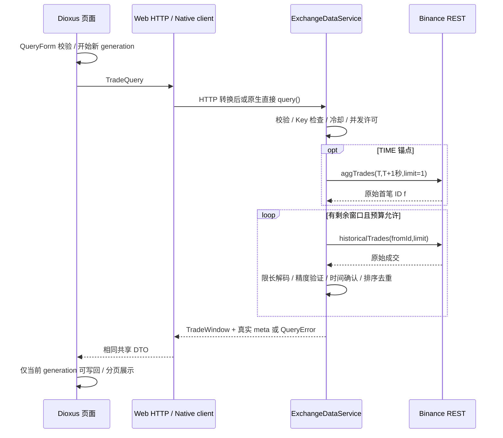
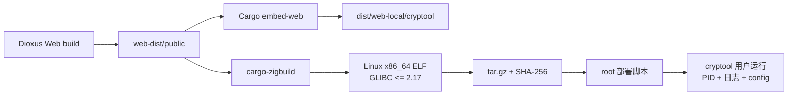

# 数据流

本文按 2026-09-11 的 `main` 分支（`5093712`）核对。

## Web / Desktop 共用查询



Web 的 API Key 和代理只在 Axum 端；Native client 不启动 HTTP 服务，也不通过 CLI 子进程调用服务。两端不会从页面传入 Key。

## ID 窗口

输入锚点1000、before499、after500、market=usdm：

```text
validate：499+500+1=1000
起始 ID：1000-499=501
第一页：fromId501，limit500 → 501..1000
第二页：fromId1001，limit500 → 1001..1500
meta：received1000，actual_before499，actual_after500，upstream_calls2
```

游标不会溢出；下界不足或上游保留范围不足时，meta 明确标记。后续分页失败可保留已取得的行，但必须 partial=true。

## TIME 窗口

```text
输入时间 + 显式单位
  → checked 转换为微秒比较基准
  → 聚合成交请求：现货微秒参数，合约毫秒参数
  → 读取 f（原始 ID）
  → 从 f-before 查询原始成交
  → 检查原始 timestamp，确认第一笔处于 [T,T+1秒] 的成交
  → 按已确认 ID 调整窗口、补齐所需页
```

聚合成交可能覆盖多个原始成交，不能仅凭 f 就断言其时间满足 T。区间没有聚合成交时返回明确空结果；原始时间尚未确认且预算不足时返回错误。查询不会无限扩大时间范围，交易所接口自身保留范围仍然适用。

## 时间转换

```text
输入字符串 / 单位
  → exchange-types::parse_time
  → Timestamp（i64 + TimeUnit）
  → format_utc / format_beijing
  → 新记录插入历史列表首位
```

无后端、无浏览器时区换算、无浮点。错误不追加历史记录。现代上海时间输出+08:00，历史秒级偏移完整保留。

## 原 CLI

```text
clap 参数
  → Settings 默认/TOML/环境/CLI 覆写
  → AppContext / 原 app 服务
  → 原 Binance adapter
  → 原 domain 模型
  → Output JSON/table
  → stdout
```

诊断输出到 stderr，不再混入 JSON stdout。原 CLI 窗口20/20、最多500及字段保持；规则筛选与账户未实现状态不变。

## 错误、取消和成本

以下仅描述 GUI/API 查询链。每个查询最多6次上游调用；每次调用遇到可重试的瞬时错误时最多重试一次。429/418 设置共享冷却时间并立即返回。history adapter 的单次响应最多2MiB，最终最多1000行。总超时或取消会释放 RAII 并发许可；Mutex 不跨 await。

价格/数量先校验 Decimal，再保留原始字符串返回，避免浮点或不必要的显示舍入。ID/时间的 JSON 字符串协议避免 WASM/浏览器跨边界产生大整数精度损失。

上述请求数量和内存上界来自实现约束；没有使用本地 mock 的延迟作为真实交易所性能指标。

## Web 构建与 Ubuntu 部署



部署脚本先正常停止旧服务，再由 root 安装二进制、脚本和只读文档；配置由 root 持有并允许服务组读取，PID/日志由服务用户写入。目标目录和受管文件拒绝符号链接，避免高权限部署跟随服务用户可控路径。运行脚本默认后台启动，也可用 `run` 交给 systemd 或容器托管。
