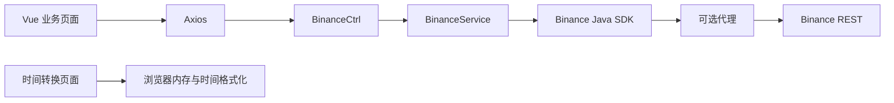

# exchange-data 架构概览

分析日期：2026-09-09。参考仓库：`/Users/xichengbot/workspace/exchange-data`，HEAD 为 `00dea82`。本文描述现状，整合后的目标架构见 [整合设计](../superpowers/specs/2026-09-09-exchange-data-web-integration-design.md)。

## 定位与规模

面向 Binance 公开历史成交查询的本地 Web 工具。实际业务是现货历史成交、USDⓈ-M 合约历史成交、时间转换；账户、订单执行、策略、数据库、实时行情推送均未实现。

受版本控制文件 216 个。Kotlin 11 个 / 394 行，Vue 58 个 / 4,244 行，TypeScript 60 个 / 2,487 行，均为含注释和空行的物理行数。前端大量文件来自 v3-admin-vite 模板，不能按文件数量判断业务复杂度。

## 技术栈

| 层次 | 当前配置 |
|---|---|
| 后端 | Java 21、Kotlin 1.9.25、Spring Boot 3.3.3 / Spring MVC |
| 上游客户端 | Binance Spot Java connector 3.2.0；Futures connector 3.0.4 |
| 前端 | Vue 3.4.38、TypeScript 5.5.4、Vite 5.4.2、Element Plus 2.8.1 |
| 页面状态 | Pinia 2.2.2、Vue Router 4.4.3，使用 hash 路由 |
| HTTP / 时间 | Axios 1.7.5、Moment 2.30.1；仓库还包含 Day.js |
| 构建 | Maven reactor 编排 pnpm 构建和 Spring Boot 打包 |
| 部署 | zip 中包含 JAR、YAML 配置、run.sh / run.bat |

## 目录

```text
exchange-data/
├── pom.xml                       # Maven 父工程
├── README.md                     # 构建说明
├── error-code.md                  # Binance 错误参考
├── be/
│   ├── pom.xml
│   └── src/
│       ├── main/kotlin/com/jcd/qa/exchange/data/
│       │   ├── ExchangeDataApplication.kt
│       │   ├── BinanceService.kt
│       │   ├── web/rest/BinanceCtrl.kt
│       │   ├── config/            # Binance / proxy / CORS
│       │   ├── exception/         # 业务和全局异常
│       │   └── model/             # 查询模式与常量
│       ├── main/resources/       # application.yml / binance.yml
│       ├── test/kotlin/          # 测试类全部注释
│       └── assembly/             # 发布 zip 与启动脚本
└── fe/
    ├── package.json / pnpm-lock.yaml / pom.xml
    ├── vite.config.ts
    ├── LICENSE                   # MIT 模板许可
    ├── src/
    │   ├── views/binance/         # 现货、合约历史成交页
    │   ├── views/tools/           # 时间转换
    │   ├── api/binance/           # 两个 API 和微秒时间格式化
    │   ├── router/               # 实际菜单和导航
    │   ├── layouts/ / components/
    │   └── store/ / hooks/ / styles/
    └── tests/                    # 模板与基础工具测试
```

## 执行架构



后端依赖方向为 Controller → Service → SDK，Configuration 负责注入 SDK / Proxy，ExceptionHandler 负责边界错误，没有发现该业务链的循环依赖。`@Lazy` 延迟创建部分 Bean，不代表异步调用。

## 并发与状态

Spring MVC 同步请求线程执行 Binance SDK 调用。配置将 Tomcat `threads.max` 和 `min-spare` 设为 1，因此慢上游请求会占用唯一业务请求线程；队列是否按声明的配置生效需要运行时核验。每次时间查询有两个顺序上游请求。

后端无数据库或查询结果持久化；SDK Bean 由容器持有。前端将查询结果和时间转换记录放在组件 ref 中，转换记录按最新在前显示。布局、主题等偏好由 Pinia / 本地存储机制维护。

登录路由和鉴权守卫已注释，后端没有认证过滤器。仓库中的用户 / 权限示例代码不构成已启用的多用户系统。

详见 [模块设计](module-design.md)、[数据流](data-flow.md) 和 [分析报告](analysis-report.md)。
