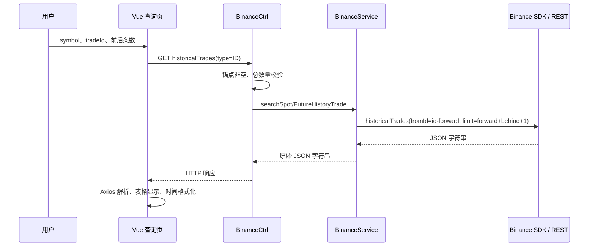

# exchange-data 数据流

## ID 查询



例如 ID=1000、forward=50、behind=50，历史接口参数是 fromId=950、limit=101。若 ID 小于 forward，则旧服务产生负 fromId。

## 时间查询

```text
任意格式时间输入
  → 页面 convertTime
  → Unix 毫秒值（数字输入被补齐 / 截断至 13 位）
  → API type=TIME&time=...
  → aggTrades(startTime=T,endTime=T+1000,limit=1)
  → 第一条记录的 f（原始首笔成交 ID）
  → historicalTrades(fromId=f-forward,limit=forward+behind+1)
  → SDK 原始响应
  → 前端结果表格
```

定位区间内没有聚合成交时，旧服务返回 null，不进行后续历史查询。实际实现不是任意跨度的“最近成交搜索”。

## 时间显示

现货：`formatTimeMicro` 用 `floor(time/1000)` 作为毫秒，保留 `%1000` 作为额外 3 位小数。合约：Moment 按毫秒显示 3 位小数。原始 Unix 值同时展示。

应用源码没有显式设置 `X-MBX-TIME-UNIT`；此次未检查第三方 SDK 内部实现，也未用真实接口确认单位。现货 API 默认毫秒、微秒响应需显式请求，因此迁移不能只复制前端的除以 1000。参见 [Binance 现货 REST 时间单位说明](https://github.com/binance/binance-spot-api-docs/blob/master/rest-api.md#general-api-information)。

## 时间转换工具

```text
输入文本 / 纯数字
  → Moment / Date
  → unixTime + gmt8Time + utcTime
  → 追加到组件 list
  → 反转列表展示最近记录
```

该页面不访问后端。含 T 的分支没有 `.utc()`，其标为“国际时间”的列仍使用本地时间；“北京时间”也依赖浏览器本地时区。迁移时要固定 Asia/Shanghai 与 UTC，支持明确的秒 / 毫秒 / 微秒单位，避免按字符串长度任意截断。

## 配置、凭据和网络

```text
application.yml 引用 binance.yml
  → Spring ConfigurationProperties
  → Binance SDK Bean + Proxy Bean
  → Binance 请求
```

浏览器只调用应用 HTTP API，凭据留在后端。源码配置包含非空 apiKey / secretKey 值，本次没有展示或使用这些值。迁移时使用环境变量 / 私密配置路径，保留现货、合约和代理的独立配置边界。
