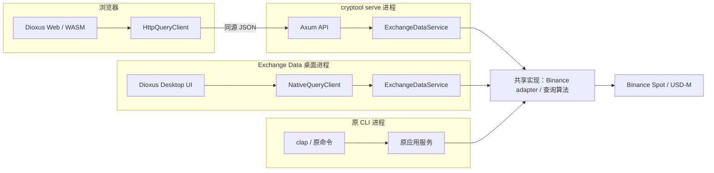

# cryptool + exchange-data：Dioxus Web / Desktop 整合设计

- 日期：2026-09-09。
- 状态：用户已确认设计，进入实现；桌面仅支持 macOS 和 Windows。
- 当前项目：`/Users/xichengbot/rustProjects/cryptool`，分析基线 `d0d5626`。
- 参考项目：`/Users/xichengbot/workspace/exchange-data`，分析基线 `00dea82`。
- 技术栈：Dioxus Web + Axum；桌面使用 Dioxus Desktop；现有 CLI 保留。
- 范围：图形界面仅复现 exchange-data 的实际业务与页面交互，不给原 CLI 的独有功能增加 Web / 桌面入口。
- 默认部署：个人使用，Web 服务默认监听 loopback；桌面独立运行。桌面目标固定为 macOS 和 Windows，不支持 Linux。macOS 在当前环境验证，Windows 使用对应 CI / 实机验证。

## 1. 产品边界

三个入口共存，但界面功能以 exchange-data 为准，不按 CLI 命令树生成页面。

| 功能 | 原 CLI | Web | Desktop |
|---|---|---|---|
| CLI 原有现货 / 合约规则查询、状态筛选 | 保留 | 不增加 | 不增加 |
| CLI 原有成交命令、参数及 JSON / table 输出 | 保留 | 不复制命令界面 | 不复制命令界面 |
| exchange-data 现货历史成交页 | 不新增对应命令 | 完整复现 | 共用相同页面 |
| exchange-data 合约历史成交页 | 不新增对应命令 | 完整复现 | 共用相同页面 |
| exchange-data 时间转换工具 | 不新增命令 | 完整复现 | 共用相同页面 |
| 原首页、侧栏、面包屑、页签、主题、全屏、菜单搜索 | 不适用 | 复现可用交互 | 相同交互，窗口能力用桌面适配 |
| CLI 账户占位、现有 Ed25519 签名 | 原样保留实际能力 | 不增加 | 不增加 |

CLI 与 exchange-data 的成交查询在底层重叠，可以复用查询实现；两种产品入口的默认参数、输入形式和历史兼容策略分别定义。共享代码不等于扩大图形界面的功能范围。

当前 `account balance` 固定返回 NotImplemented，没有实际账户查询。两个项目都没有订单执行、策略、回测或风控业务，本次不将这些预留类型扩展为功能。参考项目前端未注册的模板演示、被注释的登录页面不属于实际复现范围。

## 2. 推荐运行架构

采用“共享 Dioxus UI + 两种查询适配 + 共享原生服务”：



图中的“共享”指源码与类型复用，三个进程各自持有客户端、配置与并发状态，不共享内存对象。

### Web

- Dioxus 编译为 WASM，在浏览器客户端渲染；通过同源 HTTP 调用 Axum。
- Axum 提供 exchange-data API 和静态资源，由 `cryptool serve` 启动。
- 无 SEO 或服务端首屏要求，首期采用 CSR；不启用 SSR / hydration。
- API Key、代理认证及交易所访问配置只在服务端，浏览器不直接调用 Binance。

### Desktop

- 相同页面编译为 Dioxus Desktop，Rust 逻辑在本机原生执行，系统 WebView 渲染。
- NativeQueryClient 直接调用共享 Rust 应用服务，不经 localhost HTTP，不要求先启动 Axum，不启动子 CLI 进程。
- 桌面应用具有自己的原生客户端、配置加载及请求生命周期；网络功能仍需访问 Binance，时间转换可离线使用。
- 首期不加入远程服务器连接模式；它可作为后续第三种 QueryClient 实现，不影响页面。

### CLI

- 原命令继续执行原应用服务，保留 clap 解析、输出与配置入口。
- 增加 `serve` 子命令作为 Web 启动入口，不给旧命令自动生成路由或 UI。
- 普通 CLI 构建、执行不需要 Dioxus、系统 WebView、WASM target 或桌面 SDK。

Dioxus 官方区分了 Web 的 WASM / DOM 与 Desktop 的原生代码 / WebView 执行方式，并支持按平台 feature 隔离依赖。[平台说明](https://dioxuslabs.com/learn/0.7/guides/platforms/)

### 决策与取舍

| 决策 | 收益 | 代价 |
|---|---|---|
| 桌面直接调用 Rust 服务 | 安装后可独立启动；无需本地端口、服务发现和子进程管理 | HTTP / Native 两个薄适配器必须进行结果一致性测试 |
| 显式 Axum REST API | API 边界清楚，不把领域服务绑定到 UI 宏；可独立模拟上游和验证 | 需要维护一层 DTO 映射 |
| 一套 UI、平台能力集中适配 | 页面、表单、结果与时间逻辑共享 | 全屏、偏好存储、浏览器路由等需要分别实现 |
| Web / Desktop 单独产物 | CLI 依赖保持独立；服务端无需图形环境 | 发布时有 Web 服务包和桌面应用包两类产物 |

Dioxus Fullstack 本身支持 Axum 和 server functions；本方案使用 Dioxus 客户端渲染配合独立 Axum handlers，而不要求 Desktop 通过 server functions 访问远端。两种方式均可行，显式 API 更符合本次桌面独立运行的目标。[Axum 集成文档](https://dioxuslabs.com/learn/0.7/essentials/fullstack/axum/)

## 3. 完整技术栈

| 层次 | 选型 | 职责 |
|---|---|---|
| 语言 / 工程 | Rust stable、Edition 2024、Cargo workspace | native / WASM 目标隔离，锁定工具链与依赖 |
| 共享 UI | Dioxus 0.7 系列、RSX | 页面、表单、表格、错误与空状态 |
| Web renderer | dioxus-web | WASM、浏览器 DOM |
| Desktop renderer | dioxus-desktop | 原生 Rust、系统 WebView、窗口生命周期 |
| 路由 / 状态 | dioxus-router、signals、context、use_resource | 导航、页签状态、异步查询 |
| 样式 / 资源 | 原生 CSS、CSS variables、Grid / Flex、SVG、Dioxus assets | 主题、布局、图标与跨目标资源路径 |
| 平台适配 | 项目内 PlatformServices | 全屏、偏好存储、查询取消、启动配置状态 |
| Web HTTP 客户端 | gloo-net；必要浏览器绑定使用 web-sys / wasm-bindgen | 同源调用与 HTTP 错误映射，仅 Web target 启用 |
| Desktop 查询客户端 | NativeQueryClient | 调用原生 ExchangeDataService，无额外 HTTP 序列化 |
| HTTP 服务 | Axum 0.8、Tower、tower-http | API、静态资源、超时、请求 ID、trace、压缩 |
| 运行时 | Tokio 1.x，复用当前依赖 | 异步网络、有界并发、取消及关闭 |
| Binance 通信 | 现有 reqwest 0.13 + rustls | 客户端复用、认证、代理与数据映射 |
| 数据与配置 | serde、serde_json、toml、共享 exchange-types | DTO、校验边界、错误码、配置 |
| 数值 / 时间 | rust_decimal、chrono、chrono-tz | 金额精度、整数时间、UTC / Asia/Shanghai |
| CLI / 签名 | 现有 clap、comfy-table、ed25519-dalek 等 | 保留原有能力与输出 |
| 错误 / 日志 | thiserror、anyhow、tracing、tracing-subscriber | 分层错误、请求诊断、脱敏 |
| 原生配置目录 | directories | 平台规范的应用配置 / 偏好 / 日志路径 |
| 存储 | 内存；Web localStorage；Desktop 偏好 JSON 文件 | 不引入业务数据库，成交结果不落盘 |
| 构建工具 | Cargo、dioxus-cli（dx）、Dioxus.toml | 双目标构建、开发调试、桌面打包 |
| Web 发布 | rust-embed + cryptool 服务二进制 | 内嵌 Web 构建产物，任意工作目录可运行 |
| Desktop 发布 | dx bundle + 各平台应用包 | CSS / SVG 等资源随应用打包，依赖对应系统 WebView |
| 测试 | cargo test、固定 HTTP fixtures、Tower ServiceExt、Dioxus UI 状态测试 | 领域 / 适配器 / API / CLI 与 UI 逻辑 |
| 界面验证 | Rust WebDriver 测试 Web；桌面原生启动与交互验收 | 验证实际 renderer，不将浏览器通过当作桌面通过 |
| 质量检查 | rustfmt、Clippy、cargo audit | native / WASM 分别检查，供应链审计 |

Dioxus / Desktop 当前官方 API 文档展示 0.7.10，采用 0.7 系列并在实施时固定匹配的 dx 与相关 crate；不单独升级 renderer。现有 Cargo.lock 优先沿用，新增组合尚未编译验证。[Dioxus](https://docs.rs/dioxus/latest/dioxus/)、[Desktop](https://docs.rs/dioxus-desktop/latest/dioxus_desktop/)、[平台配置目录](https://docs.rs/directories/latest/directories/)

纯 Rust 指手写应用逻辑；Web 和 Desktop 都仍使用 HTML / CSS 及框架的浏览器桥接代码。此方案不要求 Node.js、npm、Vue、Tauri 或 Trunk。

## 4. 工程结构与依赖边界

保留根 cryptool package，增加共享类型和双目标 UI，共三个 package：

```text
cryptool/
├── Cargo.toml                       # 根 package + workspace
├── Cargo.lock
├── rust-toolchain.toml              # 实施时固定经过验证的版本
├── src/
│   ├── main.rs                      # 原 CLI，增加 serve 分支
│   ├── lib.rs                       # 暴露原生服务，不包含 UI
│   ├── cli/                         # 原命令与参数
│   ├── output/                      # 原 JSON / table
│   ├── app/
│   │   ├── ...                      # 原规则、账户、成交应用服务
│   │   └── exchange_data.rs         # 图形界面使用的成交查询 facade
│   ├── domain/                      # 原领域模型、不变量
│   ├── binance/                     # 协议、分页、认证、精度
│   ├── config/                      # 原生配置与校验
│   ├── error.rs
│   └── server/                      # 可选 server feature
│       ├── routes.rs
│       ├── handlers.rs
│       ├── error.rs
│       └── assets.rs
├── crates/exchange-types/
│   └── src/                         # DTO、校验、时间转换纯函数
├── apps/exchange-ui/
│   ├── Cargo.toml                   # web / desktop 互斥目标 feature
│   ├── Dioxus.toml
│   ├── assets/
│   └── src/
│       ├── main.rs                  # 按目标选择 bootstrap
│       ├── app.rs
│       ├── routes.rs
│       ├── pages/                   # 首页、现货、合约、时间转换
│       ├── components/              # AppShell、TradeForm、TradeTable
│       ├── client/
│       │   ├── mod.rs               # 统一 QueryClient 外观
│       │   ├── http.rs              # 仅 Web
│       │   └── native.rs            # 仅 Desktop
│       └── platform/
│           ├── web.rs               # Storage、浏览器全屏等
│           └── desktop.rs           # 配置目录、窗口、偏好文件
└── docs/
```

依赖方向：

- cryptool 原生 library → exchange-types。
- exchange-ui Web → exchange-types + dioxus-web + Web HTTP。
- exchange-ui Desktop → exchange-types + cryptool library + dioxus-desktop。
- cryptool 根 package 不依赖 exchange-ui；内嵌的是构建后的资源文件，避免循环依赖。
- 当前 config 对 output::format::OutputFormat 的依赖移到中立类型；CLI 解析和终端渲染留在 binary 边界。

workspace 设置 `default-members = ["."]`。根 package 的 `server` 控制 Axum，`embed-web` 依赖 server 且只在发布时要求存在 Web 资源。UI 的 Web 与 Desktop 分别构建，不运行会同时启用两种 renderer 的 `--all-features` 检查。原生 cryptool 依赖仅在 Desktop target 启用，不能进入 WASM 依赖图。

## 5. 页面与交互设计

```text
Exchange Data
├── 首页                          # 保留欢迎页和导航入口
├── Binance
│   ├── 现货历史成交
│   └── USD-M 合约历史成交
└── 工具
    └── 时间转换
```

不增加规则查询、账户、签名或 CLI 命令控制台页面。现货 / 合约页复用同一个 TradePage，以 market 参数控制协议差异和可见列。

| 页面能力 | 两端共同验收 |
|---|---|
| 查询输入 | symbol、ID / 时间模式、锚点、前后各 50 默认值、两个 +50 按钮 |
| 输入校验 | 空 symbol、非法 ID、负数、溢出、互斥锚点、总量超过 1,000 时阻止查询 |
| 表格 | 北京时间、原始时间与单位、trade ID、价格、数量、quote quantity、maker 标志；现货 bestMatch |
| 展示交互 | maker 颜色区分、边框、斑马纹、列宽拖动、横向滚动 |
| 结果数量 | 最大 1,000 条逻辑窗口；每页 100 条与“全部”显示选项，分页不重复请求上游 |
| 状态反馈 | 待查询、加载、结果、无数据、部分结果、失败；失败可重试 |
| 时间工具 | ISO / RFC3339、本地文本、Unix 秒 / 毫秒 / 微秒；北京时间与 UTC；最近记录置顶 |
| 应用外壳 | 侧栏、面包屑、页签、主题、菜单搜索、全屏、响应式布局 |
| 平台行为 | Web 前进 / 后退和深链接；Desktop 窗口缩放、全屏及独立启动 |

Web 保留原业务路径 `/binance/spot-history-trade`、`/binance/future-history-trade`、`/tools/time-convert`、`/dashboard`；对旧 hash 路径做入口归一化。Desktop 使用相同 route enum，由应用内导航驱动。

页面只依赖 QueryClient、PlatformServices 和共享类型。Web-specific 的 web-sys 与 Desktop-specific 的窗口 API 不能直接散落在页面组件中。表格列宽优先使用跨目标 Dioxus 指针事件；需要 DOM 能力时经过平台适配。

## 6. 服务接口与数据契约

### 应用接口

统一异步入口为 `QueryClient::query_trades(TradeQuery) -> Result<TradeWindow, QueryError>`，此处为接口语义示意。

- HttpQueryClient：请求 Axum，将 HTTP 状态 / DTO 映射成共享 QueryError。
- NativeQueryClient：调用 ExchangeDataService，并返回同一个 TradeWindow / QueryError。
- 时间转换直接调用 exchange-types 中的纯函数，无 HTTP 往返。
- 两个客户端使用同一组固定输入与上游响应进行契约测试，结果、精度和错误分类必须一致。

核心类型：

| 类型 | 内容 |
|---|---|
| Market | Spot / Usdm |
| TradeAnchor | 原始 trade ID，或带明确单位的整数时间 |
| TradeQuery | market、symbol、anchor、before、after |
| TradeRow | id、price、qty、quote_qty、timestamp、maker、可选 best_match |
| TradeWindowMeta | 请求参数、解析锚点、实际数量、实际前后数、时间精度、边界 / 不足原因、上游调用数 |
| QueryError | 稳定错误码、可展示消息、是否可重试、可选 retry_after |

参数经受验证构造 / TryFrom 进入服务，不能依赖 UI 校验，也不能让 serde 直接构造非法领域对象。

### HTTP API

| 方法 / 路径 | 内容 |
|---|---|
| GET /health | 服务存活，不返回完整配置 |
| GET /api/v1/binance/{market}/historical-trades | market 为 spot / usdm；两种市场的历史成交查询 |

查询参数：symbol、mode=id/time、互斥的 trade_id / time、时间模式必需的 time_unit=s/ms/us、before、after。不增加交易规则 / symbols / account 接口。

响应为 items + meta。ID 和整数时间在 JSON 中序列化为字符串；金额 / 数量使用十进制字符串，native 与 WASM 都不经过 JavaScript Number。共享 Timestamp 保留单位，金额业务计算仍使用后端 Decimal。

| 情况 | HTTP | Desktop / Web 共用错误语义 |
|---|---:|---|
| 参数无效 | 400 | INVALID_INPUT |
| symbol 不存在 | 404 | SYMBOL_NOT_FOUND |
| 正常查询无成交 | 200 | 空 items + 原因 |
| 限流 | 429 | RATE_LIMITED，带可用冷却时间 |
| 缺少所需凭据 | 503 | CREDENTIALS_NOT_CONFIGURED |
| 上游异常 | 502 | UPSTREAM_ERROR |
| 超时 / 查询预算耗尽 | 504 | QUERY_BUDGET_EXCEEDED |

未知 /api 路径必须返回 JSON 404，不能被 SPA 的 index.html 回退覆盖。旧 Java 两条 API 路径没有已确认的外部消费者，首期不默认保留旧 wire format；页面功能完整复现不依赖旧 API 形状。

## 7. 时间、分页与兼容策略

### 时间精度

- 现货请求显式选择 `X-MBX-TIME-UNIT: MICROSECOND`，响应按微秒解析。
- 合约按其实际毫秒协议处理，不补零假装微秒精度。
- 整数时间在单位转换时使用 checked 算术，禁止补齐 / 截断任意长度到 13 位。
- 输入含时区则按显式 offset 解析；图形界面无时区文本默认 Asia/Shanghai；CLI 保持已有 UTC 输入规则。
- 固定输出 UTC 和 Asia/Shanghai，不依赖浏览器 / 操作系统本地时区。
- 纯数字可选择单位；自动识别只处理约定长度，歧义值提示明确选择。
- Web / Desktop 使用同一时间纯函数，覆盖带 offset、跨日、微秒尾数、负值和溢出边界。

现货默认毫秒，微秒响应必须按协议显式请求。[Binance 现货时间约定](https://github.com/binance/binance-spot-api-docs/blob/master/rest-api.md#general-api-information)

### 窗口与分页

- 图形界面：默认 before=50、after=50，总量上限 1,000。
- CLI：保留默认 20 / 20、总量上限 500。
- 保留现有 ID 起点算法 `max(anchor-before, 0)` 和总量 `before+after+1`；到达 ID 下界时显示实际前后数，不虚称一定获得指定前侧数量。
- 时间查询保留指定时刻后一秒的搜索范围，取聚合成交字段 f 定位原始 ID；a 是聚合 ID，不能混用。
- 图形界面的锚点需经原始时间确认，为该区间内第一笔不早于输入时间的成交。CLI 保留已有 f 锚点策略，以显式策略参数复用底层实现，避免静默改变旧查询语义。
- 现货 historicalTrades 单页最多 1,000，USD-M 单页最多 500；合约 1,000 条逻辑窗口需顺序分页。
- 每页以 last_id+1 推进，检测溢出、重复、无进展和空页。历史可用范围或缺口导致不足时，返回实际条数与原因。
- 若已找到锚点但后续页失败，可返回明确标记的部分结果；若预算耗尽仍无法确认时间锚点，应报错，不返回锚点不明的记录集。

请求上限依据 [现货 REST](https://github.com/binance/binance-spot-api-docs/blob/master/rest-api.md#market-data-endpoints) 和 [USD-M 市场数据](https://developers.binance.com/en/docs/catalog/core-trading-derivatives-trading-usd-s-m-futures/api/rest-api/market-data)。调用次数和时间窗口都设上限，不无限补页或搜索。

### CLI 保留与必要修正

保留命令名称、参数、输出数据字段、退出码分类、显式配置路径及环境变量。抽取 library 不迁移旧命令的职责。

现有已复现问题单独列入实施验收：合约 base URL 被硬编码覆写、JSON stdout 混入诊断行。建议在共享层改造时修正地址问题；JSON 的修正限定为诊断进入 stderr、结果字段不变。无效 --future 不在本次重新定义为市场选择器，也不增添图形界面开关。账户未实现状态照实保留。

## 8. 线程、状态与容错

### Desktop

Dioxus Desktop 的窗口事件循环在主线程，启用其 tokio_runtime 支持提供多线程 Tokio 上下文；网络 Future 异步执行，不在 UI 回调中 block_on 或同步等待网络。官方当前启动代码明确不支持 current-thread Tokio runtime 与桌面事件循环组合。[Desktop 启动实现](https://docs.rs/dioxus-desktop/latest/src/dioxus_desktop/launch.rs.html)

页面持有请求任务和 generation ID：重复查询先取消旧任务，只有当前 generation 可提交结果。原生后台任务使用可取消句柄，窗口关闭或页面销毁时释放；超时 / 重试 / 分页循环都检查取消信号。关闭窗口后结束本进程服务任务，不遗留 HTTP 子服务或 CLI 子进程。

### Axum

共享 AppContext 和 reqwest 连接池；网络 await 不持有全局互斥锁。浏览器中断请求时尽可能取消，服务端总预算始终作为最终上限。HTTP 服务收到退出信号后停止接收新请求，取消 / 有界等待在途任务。

### 双端共同策略

初始建议每进程上游并发 4、每逻辑查询总预算 30 秒、单次 HTTP 最多 10 秒、每逻辑查询最多 6 次上游调用（包括重试和锚点校正）。这些是待实现验证的保护参数，不是吞吐量测量结果；CLI 原有 timeout 策略保留。

并发限制不能替代 Binance endpoint 权重限流；429 / 418 尊重冷却信息，只对预算允许的瞬时只读错误做有限重试。Web 服务与 Desktop 若同时运行，仍可能共享同一 IP 的交易所额度，本方案不承诺跨进程统一配额。

UI 状态使用 Idle / Loading / Success / Empty / Partial / Error；错误与空数据区别展示。状态不持有完整 Settings、私钥或代理密码。

## 9. 配置、偏好与安全边界

| 项目 | Web | Desktop | 原 CLI |
|---|---|---|---|
| 交易所配置来源 | 服务端 TOML / env / 启动参数 | 本机 TOML / env / 显式配置路径 | 保留原加载方式 |
| API Key 所在位置 | Axum 进程内存 | 原生服务内存 | 原 CLI 进程内存 |
| UI 偏好 | localStorage | 应用配置目录的偏好 JSON | 不适用 |
| 时间转换历史 | 会话内存 | 会话内存 | 不新增 |
| 成交数据 | 页面内存 | 页面内存 | 原输出 |

Desktop 配置选择顺序为：显式 --config 路径优先，否则查找 directories 得到的应用配置目录，缺文件时使用默认公共查询配置；选中文件后再按既有规则应用环境变量和启动参数。CLI 不因此改为自动查找用户目录。

Desktop 双击启动不依赖当前工作目录或 shell 环境。需要 Key 的功能遇到缺配置时，在页面展示所需配置项及配置文件路径；不把配置失败变成整个空白窗口，离线时间工具仍可使用。UI 偏好与凭据配置分文件，偏好写入使用原子替换，错误可恢复。

凭据只用于后端 / 原生服务，不放入序列化 DTO、RSX props、DOM、WebView bridge、浏览器 Storage 或资源包。Desktop 自身拥有 native 服务权限，但 WebView 内容只接收查询数据和脱敏状态。

生产 Web 同源 /api，默认 loopback 并检查允许的 Host；开发通过 dx 代理转发 /api，避免硬编码生产 localhost。若部署到共享网络，需补认证、TLS 入口与用户凭据边界。

代理支持 auto（环境代理）、direct、HTTP 和 SOCKS5，协议 / 认证组合按 reqwest 支持范围校验。现货公开查询不强制要求 Key；合约 historicalTrades 按上游要求使用 Key。旧 Java HMAC secretKey 不能转换成 Ed25519 PEM 私钥，也不复制参考仓库中的凭据值。

## 10. 性能预算与验证边界

| 正常完整窗口 | 上游请求数 |
|---|---:|
| 现货 ID，最多 1,000 条 | 满足单页时 1 |
| 合约 ID，最多 500 条 | 满页时 1 |
| 合约 ID，501–1,000 条 | 两页充足时 2 |
| 时间查询 | 在对应 ID 成本上至少增加 1；锚点校正可能增加调用 |

分页依赖上一页最后 ID，不能假定能并发。Desktop 直接调用省去本地 HTTP 往返和 JSON 边界，但 Binance 请求成本相同。

满窗口表格约 1,000 × 8 = 8,000 个单元格；按 100 条显示时约 800 个单元格。分页仅在已返回窗口内进行，不增加上游请求。若实测仍有布局 / 拖动卡顿，再引入虚拟滚动，不以更换 renderer 代替测量。

实施时记录 Web 首次下载体积、100 / 1,000 条解析与渲染耗时、Desktop 冷启动时间和 RSS、并发查询耗时与 429 次数。测量记录硬件、OS / WebView、构建模式和样本数；无当前基准数据，不承诺具体包体、内存或 p95。

## 11. 构建、运行与发布

以下为目标操作方式，当前尚无这些新增 feature、UI package 或 serve 子命令。

```sh
# 原 CLI 继续可用
cryptool market symbol BTCUSDT

# Web 发布版，同时服务静态页面和 API
cryptool --config /path/to/config.toml serve --listen 127.0.0.1:8080

# API 开发进程
cargo run --features server -- serve --listen 127.0.0.1:8080

# 在 apps/exchange-ui 中分别启动 UI 目标
dx serve --platform web
dx serve --platform desktop
```

发布流程：

1. Web：dx 构建 Web 资源，复制完整 public 产物到约定 staging 目录，再构建启用 server / embed-web 的 cryptool；资源清单校验完整后内嵌。普通 CLI 构建不要求 staging 目录存在。
2. Desktop：dx bundle 按目标平台构建应用与资源，不打包 Axum 子服务；配置来自用户目录。资源路径通过 Dioxus asset 管理，不依赖项目源码目录。
3. 服务版与桌面版共享版本号和 DTO 契约版本；保留纯 CLI 构建产物。
4. macOS 使用对应应用包；Windows 在对应系统完成编译、WebView2 依赖检查和交互验收后发布；不提供 Linux 桌面构建或安装包。签名 / 公证属于正式分发环节，实施构建不默认上传或公开发布。
5. 用户运行时不需要 Rust、dx、Node 或 JVM。Desktop 需要相应系统 WebView 支持，不能将其描述为完全无系统依赖的单文件应用。

Dioxus 提供 Web / Desktop 的构建与打包工具；不同平台 CSS / WebView 行为需要分别验证。[发布指南](https://dioxuslabs.com/learn/0.7/guides/deploy/)

## 12. 实施拆解与验收

| 阶段 | 交付 | 验收条件 |
|---|---|---|
| 1. 核心边界 | 根 library、exchange-types、CLI 回归基线 | 原命令与默认值保留；根 CLI 独立构建不拉入 UI / WebView；修复项有针对性验证 |
| 2. 查询服务 | ExchangeDataService、精度、分页、输入不变量、代理与请求预算 | f/a、微秒尾数、时区、20/50 默认值、500/1,000 上限、溢出、缺口、限流均有固定 fixture |
| 3. 两种客户端 | Axum API、HttpQueryClient、NativeQueryClient | 同一请求和上游 fixtures 的成功 / 部分 / 错误结果一致，HTTP 精度无损 |
| 4. 共享 UI | 三个业务页、首页、导航、平台适配 | 功能矩阵逐项核对；没有规则 / 账户页面；双目标分别编译 |
| 5. 双端验证 | Web 浏览器测试、Desktop 实际窗口交互 | +50、列宽、主题、全屏、时间转换、取消竞争、配置缺失均可用；桌面无需 Axum 即可查询 |
| 6. 发布回归 | 内嵌 Web 的服务版、桌面应用包、运行文档 | 任意目录启动；无开发服务器依赖；关闭不留任务；原 CLI 回归；各目标 fmt / Clippy / test / audit |

测试分层：

- 共享纯函数：时间、输入校验、窗口算术、错误分类，可在 native / WASM 验证。
- 原生服务：本地 HTTP fixture、代理模拟、分页、失败与预算；不依赖真实 Key。
- 契约：Native 结果与 HTTP 序列化再反序列化的结果等价；桌面不因绕过 HTTP 漏掉校验。
- UI：状态转换、过期结果抑制、表单规则与 route 行为；组件树测试不能替代真实交互。
- Web：Rust WebDriver 测试真实 DOM、浏览器导航和字段展示。
- Desktop：独立启动、实际 WebView 的列宽 / 全屏 / 窗口退出和配置目录行为。在未确认统一可用的桌面自动化工具前，使用明确的人工验收清单，不将浏览器 WebDriver 当作已覆盖 Desktop。
- CLI：现有测试与命令 / 输出 / 配置回归；无 GUI 构建依赖。

用户已确认按本文实施；具体实现和验证进度以实现计划记录为准。此前原 Rust 的 6 个测试、build、fmt 通过，严格 Clippy 有 2 处 needless_borrow；这些结果不代表整合方案已通过验收。参考 Java / Vue 仓库保持不变。

## 13. 关联分析

- cryptool：[架构](../../architecture.md)、[模块](../../module-design.md)、[数据流](../../data-flow.md)、[分析报告](../../analysis-report.md)。
- exchange-data：[架构](../../exchange-data/architecture.md)、[模块](../../exchange-data/module-design.md)、[数据流](../../exchange-data/data-flow.md)、[分析报告](../../exchange-data/analysis-report.md)。
